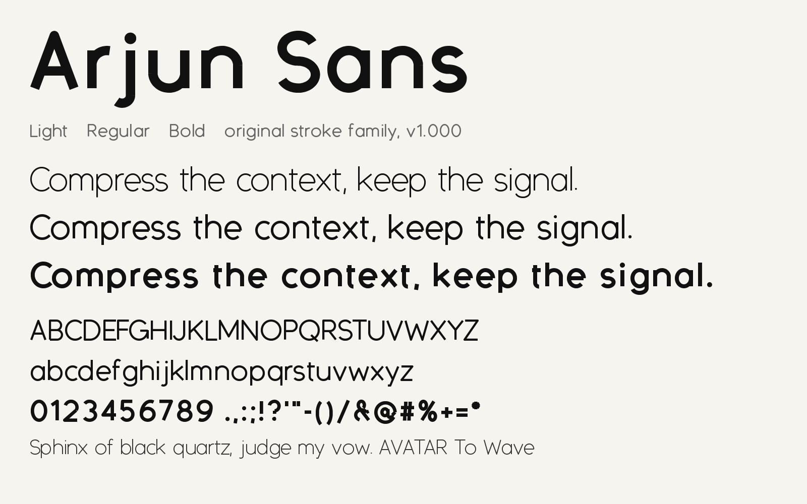

# Arjun Sans

A clean, geometric sans serif typeface by Arjun Shah, in three weights.



Live specimen: https://arjunkshah12345-hash.github.io/arjun-sans/ | Home: https://arjunshah.xyz/fonts

## Weights

| Weight | Name | Files |
| --- | --- | --- |
| 300 | Light | `ArjunSans-Light.otf`, `.ttf`, `.woff2` |
| 400 | Regular | `ArjunSans-Regular.otf`, `.ttf`, `.woff2` |
| 700 | Bold | `ArjunSans-Bold.otf`, `.ttf`, `.woff2` |

## Glyph coverage

- Uppercase: A to Z
- Lowercase: a to z
- Figures: 0 to 9
- Basic punctuation and symbols

## Install

Desktop: download the `.otf` or `.ttf` files from [`fonts/`](fonts/) and open them to install.

Web: copy the `.woff2` files into your project and add:

```css
@font-face {
  font-family: "Arjun Sans";
  src: url("fonts/ArjunSans-Light.woff2") format("woff2");
  font-weight: 300;
  font-display: swap;
}
@font-face {
  font-family: "Arjun Sans";
  src: url("fonts/ArjunSans-Regular.woff2") format("woff2");
  font-weight: 400;
  font-display: swap;
}
@font-face {
  font-family: "Arjun Sans";
  src: url("fonts/ArjunSans-Bold.woff2") format("woff2");
  font-weight: 700;
  font-display: swap;
}

body { font-family: "Arjun Sans", system-ui, sans-serif; }
```

## Repository layout

- `docs/` specimen website (served by GitHub Pages)
- `fonts/` font files (OTF, TTF, WOFF2)
- `source/` Python build scripts (`base.py`, `family.py`, `spec_family.py`)
- `images/` specimen preview

## More fonts

See https://arjunshah.xyz/fonts

## License

The fonts are licensed under the [SIL Open Font License 1.1](LICENSE). Copyright 2026 Arjun Shah.
